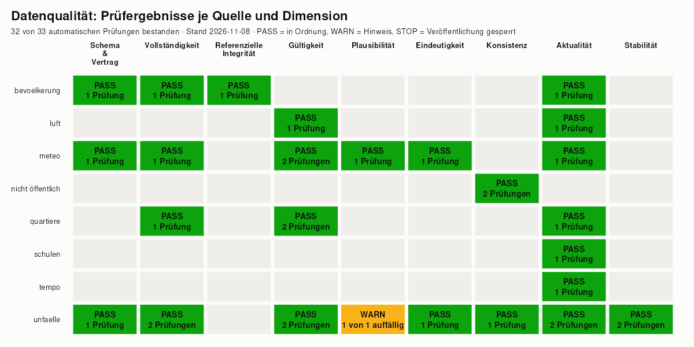

# Strassenverkehrsunfälle Stadt Zürich

**Website: [ffahrenb.github.io/zurich-road-accidents](https://ffahrenb.github.io/zurich-road-accidents/)**

[](https://github.com/ffahrenb/zurich-road-accidents/actions/workflows/pipeline.yml)

Eine Pipeline von offenen Behördendaten bis zur Erkenntnis: Open-Data-Zürich-API → DuckDB/SQL →
automatisierte Datenqualitätsprüfungen mit STOP-Gate → Modelle → Website samt DCAT-AP-CH-Metadaten.
Nichts wird veröffentlicht, solange eine STOP-Prüfung verletzt ist. Alles ist aus dem Quellcode neu
erzeugbar.



Reproduzieren (Podman, alles läuft im gepinnten Container):

```bash
make all    # build, lint, test, run (tar_make), test, site
```

> Neuaufbau 2026 der Projektarbeit aus dem CAS Data Engineering (2023, ZHAW) von Florian Fahrenbach.
> Ursprüngliches Projektteam: Flavio Clausen, Christoph Kälin, Florian Fahrenbach.

## Grundsätze

- Reproduzierbar: Container-Image, Basis-Image per Digest, Abhängigkeiten und Datenstände (Snapshot mit SHA-256) sind gepinnt. `targets` baut nur Geändertes neu.
- Datenqualität vor Veröffentlichung: Datenverträge, SQL-Prüfungen und Snapshot-Vergleiche laufen automatisch. Eine verletzte STOP-Prüfung bricht die Pipeline ab ([`docs/datenqualitaet.md`](docs/datenqualitaet.md)).
- Datenschutz: Veröffentlicht werden nur Aggregate mit Mindestfallzahl. Ein Test erzwingt das bei jedem Lauf und im Pre-Commit-Hook ([`docs/datenschutz.md`](docs/datenschutz.md)). Nicht öffentliche Unfallzeitpunkte fliessen nur als Modellresultate mit Mindestfallzahl ein.
- Offene Standards: CSV, Parquet, GeoJSON, Metadaten als DCAT-AP CH (JSON-LD) mit Datenwörterbuch.
- Erklärt für Nicht-Fachleute: Die Website ordnet Ergebnisse ein, nennt Grenzen und zeigt die Prüfungen.

## Architektur

Drei Schichten, je ein SQL-Ordner in DuckDB ([ADR 0003](docs/adr/0003-schichten-raw-staging-mart.md)):

1. `raw`: 1:1-Kopien der heruntergeladenen Dateien.
2. `staging`: typisiert, bereinigt, Codelisten aufgelöst.
3. `mart`: angereichert (Quartier, Schulnähe, Tempo, Wetter) und aggregiert.

Dazwischen das DQ-Gate. Modelle und Exporte laufen erst danach.

| Baustein | Werkzeug |
|----------|----------|
| Orchestrierung | R, `targets` |
| Transformation | SQL, DuckDB (+ spatial) |
| Datenqualität | `pointblank` (Verträge), SQL-Prüfungen, R-Historienprüfungen |
| Modelle | `tidymodels` (Schweregrad), Negative-Binomial-Regression (Wetter) |
| Publikation | Quarto-Website, DCAT-AP CH |

Ablauf als Diagramm: [`docs/pipeline.md`](docs/pipeline.md).

## Datenquellen und Lizenzen

Abruf direkt beim Herausgeber, Konfiguration in [`config/sources.yml`](config/sources.yml).

| Quelle | Herausgeber | Lizenz |
|--------|-------------|--------|
| Strassenverkehrsunfälle (Unfallorte) | ASTRA, via Stadt Zürich | CC BY 4.0 |
| Meteodaten, Luftschadstoffe (Stundenwerte) | Stadt Zürich, UGZ | CC0 |
| Bevölkerung nach Quartier | Statistik Stadt Zürich | CC0 |
| Statistische Quartiere, Schulanlagen, Signalisierte Geschwindigkeiten | Stadt Zürich | CC0 |

Quelle: Open Data Zürich, [data.stadt-zuerich.ch](https://data.stadt-zuerich.ch). Abgeleitete Daten unter `export/data/`: CC BY 4.0 mit Quellennennung. Code: MIT.

## Repository-Struktur

```text
R/            Pipeline-Funktionen (Ingest, Warehouse, DQ, Modelle, Export, Metadaten)
sql/          raw/ staging/ mart/ und dq/ (eine Datei pro Prüfung, Metadaten im Kopf)
dq/contracts/ Datenverträge je Quelle (YAML)
config/       Quellen, Export-Allowlist, Codebook
export/       veröffentlichte Ergebnisse: data/ dq/ meta/ modell/ trackx/
site/         Quarto-Website
tests/        testthat: DQ-Engine mit absichtlich kaputten Testdaten, Datenschutz, Lint
tools/        Pre-Commit-Hook (Datenschutz), DQ-Prüfübersicht
docs/         Dokumentation, Entscheidungen unter docs/adr/
docker/       Containerfile
```

Weiteres: [`docs/`](docs/) (Pipeline, Datenqualität, Datenschutz), [`docs/adr/`](docs/adr/) (DuckDB, targets, Schichten, zwei Datenpfade, DQ als Freigabe).

Targets: `make lint`, `make test`, `make run`, `make site`, `make hooks` (Pre-Commit-Hook installieren). Die Prüfübersicht entsteht mit `Rscript tools/dq_scorecard.R`.

## English summary

Road accident data of the City of Zurich, from open data to insight: Open Data Zurich API → DuckDB/SQL → automated data-quality checks with STOP gate → models → website with DCAT-AP CH metadata. Nothing is published while a STOP check fails.

- Reproducible: pinned container image, dated snapshots with SHA-256, `targets` DAG. Run `make all`.
- Data quality: data contracts, SQL checks, snapshot comparison.
- Privacy: only aggregates with a minimum case count are published, enforced by a test and a pre-commit hook. Non-public accident times appear only as model results with a minimum case count.
- Open standards: CSV, Parquet, GeoJSON, DCAT-AP CH. Licences: accident data CC BY 4.0 (FEDRO/ASTRA via City of Zurich), other sources CC0.
- Rebuilt in 2026 from the 2023 CAS Data Engineering (ZHAW) project by Florian Fahrenbach; original team: Flavio Clausen, Christoph Kälin, Florian Fahrenbach.
