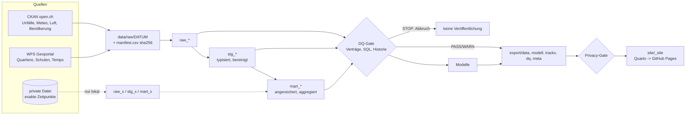

# Pipeline

## Lineage

Schichten: ADR 0003. Orchestrierung: ADR 0002 (`_targets.R`). Gate: ADR 0005.

## Ausführen

Alles läuft im Container (`localhost/zh-unfaelle:dev`); R ist auf dem Host nicht nötig.

| Befehl | Wirkung |
|--------|---------|
| `make build` | Image bauen (`docker/Containerfile`) |
| `make run` | `targets::tar_make()`. Mit `ZH_PRIVATE_ACCIDENTS=/pfad/datei.csv` wird die private Datei read-only gemountet und Track X gebaut |
| `make test` | testthat inkl. Datenschutz-Gate |
| `make lint` | lintr (R) und sqlfluff (SQL) |
| `make site` | `quarto render site/` nach `site/_site` |
| `make hooks` | Pre-Commit-Datenschutzhook installieren |
| `make all` | Bauen, Lint, Test, Pipeline, Test, Site |

CI (`.github/workflows/pipeline.yml`) macht dasselbe ohne private Datei: Lint, Tests, `tar_make()`,
Privacy-Gate, Site, Deployment auf GitHub Pages (nur `main`, Zeitplan, manuell). Alle Actions
sind auf Commit-SHA festgelegt.

## Reproduzierbarkeit

- Laufzeit: Basis-Image `rocker/geospatial:4.5.1` per Digest fixiert (kein beweglicher Tag).
- R-Pakete: aus einem datierten Posit-Package-Manager-Snapshot (`2025-10-30`), Liste in
  `docker/packages.txt`; das Image prüft, dass alle installiert sind.
- DuckDB-Extensions (`spatial`, `icu`) werden beim Build installiert, zur Laufzeit wird nichts
  nachgeladen. sqlfluff ist auf 3.4.2 festgelegt.
- Daten: Jeder Lauf zieht einen datierten Snapshot nach `data/raw/<Datum>/` mit
  `manifest.csv` (Quelle, URL, Änderungsdatum, SHA-256 je Datei). Ein erneuter Lauf am selben
  Tag verwendet denselben Snapshot. Stille Änderungen der Quelle fallen über die
  Historienprüfungen (DQ-S01/S02) auf.
- Tests und Gate laufen bei jedem Push, Pull Request und monatlich.

## Lizenzen

- Code: MIT (`LICENSE`, 2026 Florian Fahrenbach).
- Daten: je Quelle. Strassenverkehrsunfälle (ASTRA / Stadt Zürich): CC BY 4.0, mit
  Quellenangabe. Meteo, Luft, Bevölkerung, Quartiere, Schulen, Tempo (Stadt Zürich): CC0.
  Abgeleitete Dateien in `export/` behalten die Pflichten der Eingangsquelle (Quellenangabe für
  Unfalldaten). Die Lizenzangaben stehen in `config/sources.yml` und im Katalog
  `export/meta/katalog.jsonld`.
- Die private Datei der Stadt Zürich ist nicht Teil des Projekts und nicht lizenziert zur
  Weitergabe.
