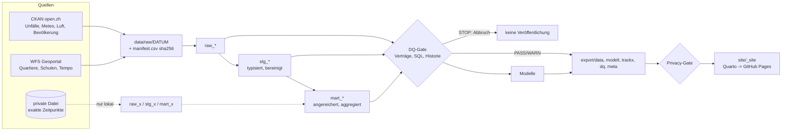

# Pipeline

## Lineage

Schichten: ADR 0003. Orchestrierung: ADR 0002 (`_targets.R`). Gate: ADR 0005.

## Ausführen

Alles läuft im Container (`localhost/zh-unfaelle:dev`); R ist auf dem Host nicht nötig.

| Befehl | Wirkung |
|--------|---------|
| `make build` | Image bauen (`docker/Containerfile`) |
| `make run` | `targets::tar_make()`. Mit `ZH_PRIVATE_ACCIDENTS=/pfad/datei.csv` wird die private Datei read-only gemountet und Track X gebaut |
| `make test` | testthat inkl. Datenschutz-Gate |
| `make lint` | lintr (R) und sqlfluff (SQL) |
| `make site` | `quarto render site/` nach `site/_site` |
| `make hooks` | Pre-Commit-Datenschutzhook installieren |
| `make all` | Bauen, Lint, Test, Pipeline, Test, Site |

CI (`.github/workflows/pipeline.yml`) macht dasselbe ohne private Datei: Lint, Tests, `tar_make()`,
Privacy-Gate, Site, Deployment auf GitHub Pages (nur `main`, Zeitplan, manuell) und, bei Zeitplan und
manuellem Start auf `main`, das Zurückschreiben von `export/` (Abschnitt Automatisierung). Alle
Actions sind auf Commit-SHA festgelegt.

## Automatisierung (monatlicher Lauf)

Ziel: Der Lauf braucht keine Handarbeit. Neue Datenjahre werden aufgenommen, die Ergebnisse
landen im Repository, Prüfverlauf und Snapshot-Vergleiche wachsen von Lauf zu Lauf (ADR 0006).

**Zeitplan.** `schedule: 17 4 1 * *` (monatlich, 1. des Monats, 04:17 UTC) und `workflow_dispatch`.
Push und Pull Request bauen und prüfen, schreiben aber nichts zurück.

**Automatischer Jahresbereich.** `config/sources.yml` setzt `years: {from: 2011, to: auto}`
(`R/years.R`, Tests in `tests/testthat/test-years.R`). `to` ist das neueste Jahr, für das **alle**
Eingänge vorliegen:

| Eingang | Regel |
|---------|-------|
| Unfälle (eine Parquet-Datei, alle Jahre) | neuestes Jahr in der heruntergeladenen Datei |
| Meteo, Luft (eine Datei je Jahr) | CKAN-Ressourcenliste (`ugz_ogd_meteo_h1_{year}.csv`, `..._air_h1_{year}.csv`); das Jahr muss lückenlos ab `from` vorhanden sein |
| Bevölkerung (eine Datei, alle Jahre) | begrenzt den Bereich **nicht** |

Reihenfolge im Ingest: erst die Einzeldateien (Unfälle, Bevölkerung, Geodaten), dann Auflösung des
Bereichs, dann die Jahresdateien für genau `from..to`. Das Ergebnis steht in `data/raw/<Datum>/years.csv`,
in den Spalten `year_from`/`year_to` des Manifests, in `export/dq/jahresbereich.csv` (eine Zeile je
Snapshot, committet) und im DCAT-Zeitraum (`dct:temporal`). SQL, DQ, Katalog und Website lesen den
aufgelösten Bereich (`cfg_run` in `_targets.R`), nie `cfg$years`. Mit `to: 2024` (Zahl) wird der
Bereich festgesetzt und die Automatik übersprungen.

*Teiljahr.* Hat das neueste Unfalljahr weniger als 80 % der Unfälle des Vorjahres, gilt es als
unvollständig und wird ausgelassen (Bereich endet ein Jahr früher): DQ-S03 (WARN).

*Bevölkerung hinkt nach.* Die Quartier-Raten brauchen die Einwohnerzahl je Jahr. Fehlt sie für das
neueste Unfalljahr, schreibt `mart_quartier` den **neuesten vorhandenen Stand fort** (Spalte
`einwohner_jahr`) statt den Bereich anzuhalten oder die Rate leer zu lassen. DQ-B03 (WARN) listet
jedes fortgeschriebene Jahr; sobald die Stadt das Jahr nachliefert, verschwindet die Warnung ohne
Eingriff. Die Bevölkerung am Jahresende ändert sich langsam, der Fehler ist klein und sichtbar.

*Rückschritt verboten.* DQ-S04 (STOP): schrumpft der aufgelöste Bereich gegenüber dem letzten
Snapshot in `jahresbereich.csv` (früheres Ende oder späterer Beginn), bricht der Lauf ab; die
Zeile des fehlgeschlagenen Laufs wird nicht geschrieben, ein Wiederholen heilt den Vergleich nicht.
DQ-S05 (WARN) nennt die Quelle, die den Bereich begrenzt (z. B. Meteo-Jahr fehlt in CKAN).

**Persistenz.** Der Job `build` lädt nach allen Gates (Lint, Tests, DQ-Gate in `tar_make()`,
Datenschutz-Gate, Track-X-Prüfung) `export/` samt `SHA256SUMS` als Artifact hoch (nur bei
`schedule`/`workflow_dispatch`). Der Job `persist` (einziger mit `contents: write`; nur auf `main`,
nach `build` und `deploy`) ruft `tools/persist-export.sh` auf:

1. Artifact gegen `SHA256SUMS` und eine Pfad-Allowlist prüfen (`data dq meta modell trackx`,
   keine Symlinks, keine `*unfaelle*.csv`, keine `.duckdb`). Das sind genau die Bytes, die das
   Datenschutz-Gate im Build gesehen hat.
2. Arbeitsbaum auf `origin/main` zurücksetzen (`main` kann sich seit dem Checkout bewegt haben).
3. `export/` ersetzen, **ausser `export/trackx`**, das aus dem Checkout unverändert bleibt.
4. Nur wenn `git status --porcelain export/` nicht leer ist: Commit
   `chore(data): refresh <UTC-Datum> [skip ci]` als `github-actions[bot]`, Push auf `main`.
   Der Lauf bricht ab, sobald etwas ausserhalb `export/` geändert wäre.
5. Verliert der Push ein Rennen, wird ab Schritt 2 einmal wiederholt.

Der Test `tests/testthat/test-persist-export.R` prüft das Skript offline gegen ein lokales Bare-Repo.

**Verlauf wächst.** Jeder Lauf startet vom committeten `export/`. `export_dq()` hängt an
`dq_verlauf.csv` an (eine Zeile je Snapshot und Prüfung, gleiches Datum ersetzt), `check_snapshot_delta()`
und `check_year_range()` vergleichen mit der letzten committeten Zeile *vor* dem heutigen Snapshot.
Ohne Persistenz würde jeder CI-Lauf wieder bei null beginnen.

**Fehlerverhalten.**

| Fall | Folge |
|------|-------|
| STOP-Prüfung verletzt (inkl. DQ-S02, DQ-S04) | `tar_make()` bricht ab, kein Artifact, kein Deploy, kein Commit; die letzte veröffentlichte Version bleibt stehen |
| Lint-, Test- oder Datenschutz-Fehler | wie oben |
| WARN (Teiljahr, Quelle hinkt nach, Bevölkerung fortgeschrieben) | Lauf geht durch, Warnung steht in Scorecard und `dq_ergebnisse.csv` |
| CKAN nicht erreichbar / Ressource fehlt | Ingest-Fehler, Lauf rot, nichts geändert |
| `deploy` schlägt fehl | `persist` wird übersprungen |
| Push abgelehnt (z. B. Branch-Schutz auf `main`) | `persist` rot, Daten gehen nicht verloren: der nächste Lauf holt nach |

Rote Läufe zeigt die Aktionsliste; GitHub schickt dazu die übliche Mail.

## Reproduzierbarkeit

- Laufzeit: Basis-Image `rocker/geospatial:4.5.1` per Digest fixiert (kein beweglicher Tag).
- R-Pakete: aus einem datierten Posit-Package-Manager-Snapshot (`2025-10-30`), Liste in
  `docker/packages.txt`; das Image prüft, dass alle installiert sind.
- DuckDB-Extensions (`spatial`, `icu`) werden beim Build installiert, zur Laufzeit wird nichts
  nachgeladen. sqlfluff ist auf 3.4.2 festgelegt.
- Daten: Jeder Lauf zieht einen datierten Snapshot nach `data/raw/<Datum>/` mit
  `manifest.csv` (Quelle, URL, Änderungsdatum, SHA-256 je Datei). Ein erneuter Lauf am selben
  Tag verwendet denselben Snapshot. Stille Änderungen der Quelle fallen über die
  Historienprüfungen (DQ-S01/S02) auf. Der Jahresbereich wird je Snapshot festgehalten
  (`years.csv`, `export/dq/jahresbereich.csv`).
- Tests und Gate laufen bei jedem Push, Pull Request und monatlich.

## Lizenzen

- Code: MIT (`LICENSE`, 2026 Florian Fahrenbach).
- Daten: je Quelle. Strassenverkehrsunfälle (ASTRA / Stadt Zürich): CC BY 4.0, mit
  Quellenangabe. Meteo, Luft, Bevölkerung, Quartiere, Schulen, Tempo (Stadt Zürich): CC0.
  Abgeleitete Dateien in `export/` behalten die Pflichten der Eingangsquelle (Quellenangabe für
  Unfalldaten). Die Lizenzangaben stehen in `config/sources.yml` und im Katalog
  `export/meta/katalog.jsonld`.
- Die private Datei der Stadt Zürich ist nicht Teil des Projekts und nicht lizenziert zur
  Weitergabe.
